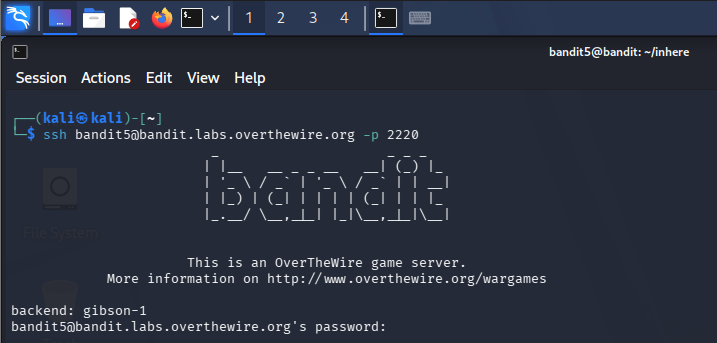
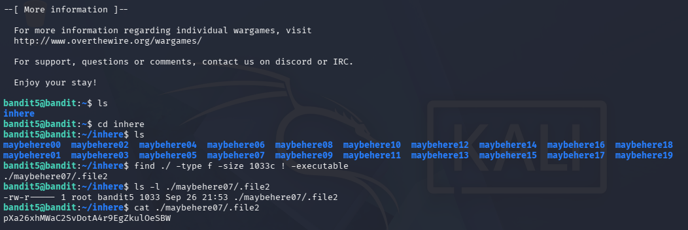

- Autor: **Fernando (fabri_is_boy)**
- Tipo de documento: **write-up**

---

# Write-up: OverTheWire Bandit — Level 5 → Level 6

## 1. Introducción

En esta práctica se resolvió el nivel 5 → 6 del laboratorio Bandit de OverTheWire. El objetivo consiste en encontrar un archivo dentro del directorio `inhere` que cumpla determinadas características y cuyo contenido corresponde a la contraseña necesaria para acceder al siguiente nivel.

## 2. Objetivo

Encontrar un archivo ubicado en algún lugar dentro del directorio `inhere` que cumpla las siguientes condiciones:

- Ser legible por una persona (*human-readable*).
- Tener un tamaño de exactamente 1033 bytes.
- No ser ejecutable.

Para resolver el ejercicio se utilizaron diferentes comandos de Linux, principalmente `ls`, `cd`, `find`, `file`, `cat` y `ls -l`.

## 3. Procedimiento

### 3.1. Conexión al servidor

Primero se estableció una conexión SSH con el servidor de OverTheWire utilizando el usuario correspondiente al nivel:

```bash
ssh bandit5@bandit.labs.overthewire.org -p 2220
```

Después de ejecutar el comando, se ingresó la contraseña correspondiente al usuario `bandit5`.



*Figura 1. Conexión al servidor de OverTheWire mediante SSH.*

### 3.2. Inspección del directorio

Una vez dentro del servidor, se utilizó el comando `ls` para observar el contenido del directorio actual:

```bash
ls
```

El resultado mostró el directorio `inhere`. Por ello, se ingresó utilizando:

```bash
cd inhere
```

Luego se volvió a ejecutar:

```bash
ls
```

Se encontraron varios directorios con nombres similares a `maybehere00`, `maybehere01`, `maybehere02`, hasta `maybehere19`.

Debido a la cantidad de directorios, revisar cada uno manualmente no era lo más eficiente. Por ello, se decidió utilizar el comando `find` para realizar una búsqueda automática.

### 3.3. Búsqueda del archivo

Se utilizó el siguiente comando:

```bash
find ./ -type f -size 1033c ! -executable
```

El resultado obtenido fue:

```text
./maybehere07/.file2
```



*Figura 2. Búsqueda y localización del archivo mediante el comando `find`.*

## 4. Análisis del comando `find`

El comando utilizado fue:

```bash
find ./ -type f -size 1033c ! -executable
```

Cada parte del comando cumple una función específica:

| Elemento | Función |
|---|---|
| `find` | Permite buscar archivos y directorios. |
| `./` | Indica que la búsqueda comienza desde el directorio actual. |
| `-type f` | Busca únicamente archivos regulares. |
| `-size 1033c` | Busca archivos de exactamente 1033 bytes. |
| `! -executable` | Excluye los archivos que tienen permiso de ejecución. |

De esta manera, se redujo la cantidad de archivos que debían revisarse manualmente.

## 5. Verificación del archivo

Después de localizar el archivo `./maybehere07/.file2`, se verificaron sus permisos mediante:

```bash
ls -l ./maybehere07/.file2
```

El resultado mostró una estructura de permisos similar a:

```text
-rw-r--r--
```

La ausencia de la letra `x` indica que el archivo no posee permisos de ejecución.

También se puede comprobar el tipo de contenido mediante:

```bash
file ./maybehere07/.file2
```

Este comando permite identificar si el archivo contiene texto legible u otro tipo de información.

## 6. Obtención de la contraseña

Finalmente, se utilizó el comando `cat` para mostrar el contenido del archivo:

```bash
cat ./maybehere07/.file2
```

El comando mostró una cadena de caracteres que corresponde a la contraseña necesaria para acceder al siguiente nivel.


## 7. Resultado

El archivo que cumplía con las características principales del ejercicio fue:

```text
./maybehere07/.file2
```

Las características verificadas fueron:

- Es un archivo regular.
- Tiene un tamaño de 1033 bytes.
- No posee permisos de ejecución.
- Su contenido puede visualizarse mediante el comando `cat`.

El uso de `find` permitió localizar el archivo de manera eficiente, sin necesidad de revisar manualmente todos los directorios.

## 8. Conclusiones

En esta práctica se reforzó el uso de comandos básicos de Linux aplicados a la búsqueda y análisis de archivos.

El comando `find` fue fundamental porque permitió combinar diferentes criterios de búsqueda en una sola instrucción. Asimismo, se practicó la interpretación de permisos mediante `ls -l`, la identificación del tipo de archivo mediante `file` y la visualización de su contenido mediante `cat`.


## 9. Referencia

OverTheWire. **Bandit — Level 5 → Level 6**.

https://overthewire.org/wargames/bandit/bandit6.html
