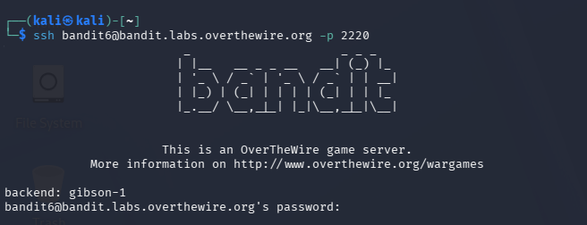
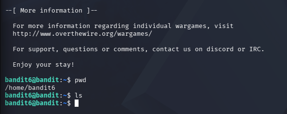
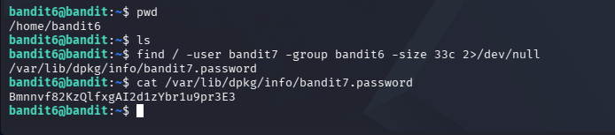

- Autor: **Fernando (fabri_is_boy)**
- Tipo de documento: **write-up**

---

# Write-up: OverTheWire Bandit — Level 6 → Level 7

## 1. Introducción

En esta práctica se resolvió el nivel 6 → 7 del laboratorio Bandit de OverTheWire.

## 2. Objetivo

La contraseña para el siguiente nivel se encuentra en un archivo que cumple las siguientes condiciones:

- Pertenece al usuario `bandit7`.
- Pertenece al grupo `bandit6`.
- Tiene un tamaño de exactamente **33 bytes**.

Debido a que el archivo puede encontrarse en cualquier ubicación del sistema, se utilizará el comando `find` para localizarlo.

## 3. Procedimiento

### 3.1. Conexión al servidor

Primero se estableció una conexión mediante SSH con el servidor de OverTheWire utilizando el usuario correspondiente al nivel:

```bash
ssh bandit6@bandit.labs.overthewire.org -p 2220
```

Después de ejecutar el comando, se ingresó la contraseña correspondiente al usuario `bandit6`.



*Figura 1. Conexión al servidor de OverTheWire mediante SSH.*

### 3.2. Verificación del directorio actual

Una vez establecida la conexión, se utilizó el comando `pwd` para conocer el directorio de trabajo actual:

```bash
pwd
```

El resultado fue:

```text
/home/bandit6
```

Posteriormente, se utilizó el comando `ls`:

```bash
ls
```

No se encontraron archivos en el directorio actual.



*Figura 2. Verificación del directorio de trabajo mediante los comandos `pwd` y `ls`.*

### 3.3. Búsqueda del archivo

Como la contraseña podía encontrarse en cualquier ubicación del sistema, se utilizó el comando `find` con los criterios indicados en el objetivo:

```bash
find / -user bandit7 -group bandit6 -size 33c 2>/dev/null
```

El comando devolvió la siguiente ruta:

```text
/var/lib/dpkg/info/bandit7.password
```



*Figura 3. Localización del archivo mediante `find` y lectura de su contenido.*

### 3.4. Análisis del comando `find`

El comando utilizado fue:

```bash
find / -user bandit7 -group bandit6 -size 33c 2>/dev/null
```

Cada parte cumple una función específica:

| Elemento | Función |
|---|---|
| `find` | Permite buscar archivos y directorios. |
| `/` | Indica que la búsqueda comienza desde la raíz del sistema. |
| `-user bandit7` | Busca archivos cuyo propietario sea `bandit7`. |
| `-group bandit6` | Busca archivos cuyo grupo propietario sea `bandit6`. |
| `-size 33c` | Busca archivos cuyo tamaño sea exactamente 33 bytes. |
| `2>/dev/null` | Oculta los mensajes de error relacionados con permisos. |

De esta manera, el comando permite filtrar los archivos del sistema hasta encontrar aquel que cumple simultáneamente con las condiciones establecidas.

### 3.5. Obtención de la contraseña

Después de localizar el archivo:

```text
/var/lib/dpkg/info/bandit7.password
```

se utilizó el comando `cat` para mostrar su contenido:

```bash
cat /var/lib/dpkg/info/bandit7.password
```

El resultado mostrado corresponde a la contraseña necesaria para acceder al nivel `bandit7`.


## 4. Resultado

El archivo que contenía la contraseña fue:

```text
/var/lib/dpkg/info/bandit7.password
```

Este archivo cumplía con las condiciones establecidas:

- Su propietario era `bandit7`.
- Su grupo era `bandit6`.
- Su tamaño era de **33 bytes**.

El uso de `find` permitió localizar el archivo directamente en el sistema sin tener que revisar manualmente cada directorio.

## 5. Conclusiones

En esta práctica se reforzó el uso del comando `find` para realizar búsquedas de archivos utilizando diferentes criterios.

A diferencia del nivel anterior, en este caso fue necesario realizar la búsqueda desde la raíz del sistema, debido a que el archivo podía encontrarse en cualquier ubicación.

También se aprendió a utilizar criterios relacionados con el propietario, el grupo y el tamaño de un archivo.


## 6. Referencia

OverTheWire. **Bandit — Level 6 → Level 7**.

https://overthewire.org/wargames/bandit/bandit7.html
