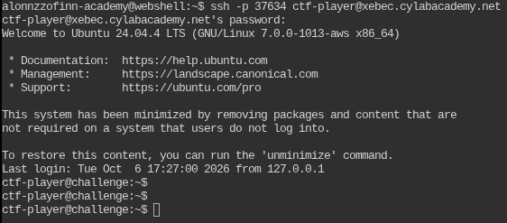
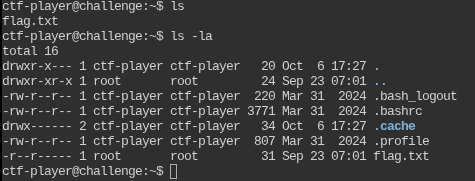
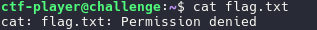
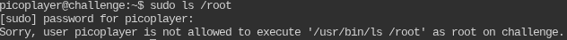
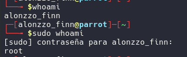
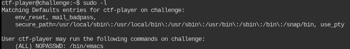
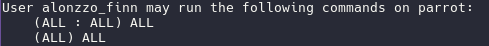
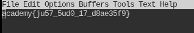
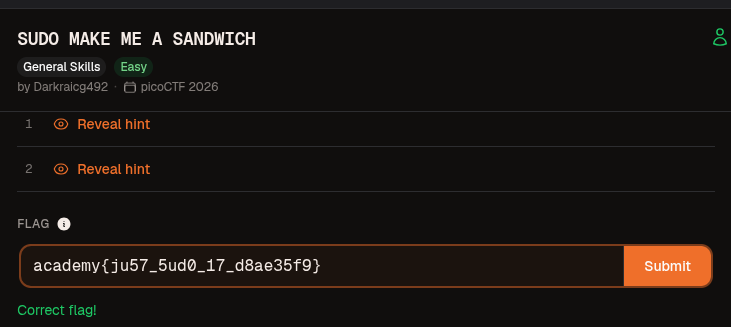

- Autor: [Alonzzofinn24](https://github.com/Alonzzofinn24)
- Fuente original: [SUDO MAKE ME A SANDWICH](https://github.com/Alonzzofinn24/CCC_writeups_Linux/tree/main/Linux/SUDO%20MAKE%20ME%20A%20SANDWICH)
- Tipo de documento: **write-up**

---

# 🥪 SUDO MAKE ME A SANDWICH

---

## Información del reto

- **Plataforma:**  PicoCTF - CyLab
- **Categoría:**  General Skills
- **Reto:**  sudo make me a sandwich

---

## Enunciado

> Can you read the flag? I think you can!

---

## Opciones a tomar

- Primero, notamos que debemos conectarnos vía SSH a un entorno remoto en el que podremos interactuar.
- Nos conectamos mediante las credenciales que nos da el reto y vemos que se nos cambia el entorno.

  <p align="center">
  
</p>
- Una vez dentro podemos ver el contenido de este listando los archivos con `ls`.

  <p align="center">
  
</p>

  Como es muy poco lo que se encontró, aplicamos un `ls -la` para ver los archivos ocultos del directorio en el que nos encontramos.
- Vemos que el único archivo que es obvio encontrar la flag (el archivo `flag.txt`) tiene como dueño al usuario `root` por lo que si queremos inspeccionar su contenido tendremos el siguiente resultado.

  <p align="center">
  
</p>

---

Después de todo este análisis, lo importante es plantearnos que cómo podemos acceder al contenido de este archivo si el usuario actual no tiene permisos suficientes.

Para ello ejecutaremos el siguiente comando: `sudo -l`, pero antes de esto,  **¿que es sudo?**

---

## Comando `sudo`

Significa de manera abreviada  **"superuser do"** , y este permite que un usuario autorizado ejecute un comando con los privilegios de otro usuario, normalmente `root`.

Su estructura básica es la siguiente:

```bash
sudo [opciones] comando [argumentos]
```

Veamos un ejemplo en el mismo reto:

<p align="center">
  
</p>

Como notamos, al ejecutar el comando `sudo ls /root` le estamos diciendo a la terminal que queremos ver el contenido de la carpeta `/root` desde el usuario actual.  
Si tenemos los permisos, mostrará el contenido; de lo contrario nos aparecerá un mensaje diciéndonos que el usuario actual no los tiene.

Ojo: para saber cuál es el usuario actual podemos usar el comando `whoami` y usarlo ju nto con `sudo` para verificar al usuario raíz, veamos:

<p align="center">
  
</p>

Esto demuestra algo importante, y es que `sudo` no te cambia de usuario al de raíz (`root`), sino lo que hace es ejecutar un comando en concreto con los **privilegios elevados** de este.

### Entonces, ¿qué haría `sudo -l`?

La opción `-l` nos permite ver una lista de comandos permitidos (y prohibidos) para el usuario que realiza la llamada en el host actual.

Si queremos ver un ejemplo más sencillo de la información que proporciona este comando, ejecutamos un `sudo --help`, y en el apartado de `-l` nos sale la siguiente información:

```bash
-l, --list                    lista privilegios de usuario o chequea un
							  comando especifico; usar dos veces para formato
                              extenso
```

Por tanto, al ejecutarlo en el usuario actual (`ctf-player`), obtenemos lo siguiente:

<p align="center">
  
</p>

Como primer vistazo tenemos las `Matching Defaults` que son las opciones predeterminadas de `sudo` que se aplican a ese usuario.

Debajo de esto está la información que necesitamos, los permisos.  
Y es que el formato para los permisos puede ir desde un solo usuario a varios y/o muchos grupos.

Esto viene de una regla de sintaxis de `sudoers` (archivo que configura y administra los usuarios que pueden ejecutar comandos con privilegios `root`)

```bash
(user) HOST = (user_source : group) OPCIONES: comandos_permitidos
```

- `user`: Es el nombre actual del usuario que estamos usando y sobre el que queremos aplicar los permisos. Cuando usamos `sudo -l`, esta información suele omitirse.
- `HOST`: Las máquinas o redes desde las cuales podemos ejecutar el comando. Mayormente aparece como `ALL`.
- `user_source : group`: Son las identidades que aplicarán los comandos con mayores privilegios (normalmente es `root`). Indica que podemos ejecutar el comando que queramos como si fuésemos ese usuario o grupo específico.
- `OPCIONES`: Son directivas opcionales como `NOPASSWD` significa que no es necesario el registro de alguna contraseña para usar `sudo`.
- `comandos_permitidos`: Son las rutas absolutas (los directorios donde se encuentran los scripts que realizan las funciones de los comandos) de los programas que como usuario actual tenemos permitido usar.  
  Por ejemplo: `/usr/bin/apt`, `/bin/systemctl` o incluso `ALL` si tenemos acceso total como cada usuario en su PC personal.  
  <p align="center">
  
</p>

---

Dada toda esta explicación teórica, al haber aplicado `sudo -l` obtuvimos lo siguiente:

```bash
User ctf-player may run the following commands on challenge:
	(ALL) NOPASSWD: /bin/emacs
```

Con esto podemos concluir que el entorno nos permite usar el comando `emacs` mediante `sudo` sin necesidad de introducir una contraseña (`NOPASSWD`).

---

Después de entender esto podemos verificar que el único comando que tenemos como usuario actual es `emacs`.

---

## Comando `emacs`

Buscando información en internet, nos dice que este es uno de los editores de texto más antiguos, potentes y personalizables que existen para sistemas operativos basados en Linux.

Pero lo importante no es analizar todo su funcionamiento, sino, cómo acceder al contenido del archivo `flag.txt`.

Nos dice que para acceder al archivo debemos de ejecutar el comando con la siguiente sintaxis:

```bash
emacs -nw [archivo.txt]
```

Donde la opción `-nw` significa `No Window`, ya que así `emacs` no abrirá su interfaz gráfica (GUI), sino que mostrará todo de la misma terminal.

---

Ejecutamos un `emacs -nw flag.txt` y nos arroja el siguiente resultado:

<p align="center">
  
</p>

---

## Comandos empleados en la terminal

- `ssh`: Se utilizó el comando para conectarse remotamente al servidor del reto con las credenciales proporcionadas.
- `ls/ ls -la`: Lista los archivos presentes en un directorio. La opción `-la` permite ver de manera ordenada y detallada los metadatos (`-l`) de todos los archivos, incluso los ocultos (`-a`) en ese mismo directorio.
- `sudo`: Permite ejecutar un comando con permisos de otro usuario, por lo general con uno que tenga privilegios elevados como `root`.
- `sudo -l`: Muestra los comandos que el usuario actual tiene autorización para ejecutar en el mismo entorno.
- `emacs`: Nos permite editar texto avanzado y extensible, pero su diseño le permite funcionar como un sistema operativo dentro de la terminal.

---

## Datos importantes

- **El propietario del archivo importa:** `flag.txt` pertenece a `root`, por lo que el usuario `ctf-player` no necesariamente puede leerlo directamente. Los permisos efectivos dependen del propietario, el grupo y los permisos asignados al archivo.
- **`ls -la` ayuda al reconocimiento:** muestra archivos ocultos y detalles como permisos, propietario y grupo. Es útil para detectar archivos relevantes y entender por qué el acceso podría estar restringido.
- **`sudo -l` revela los privilegios asignados:** permite comprobar qué comandos puede ejecutar el usuario mediante `sudo`. En este reto aparece la regla `(ALL) NOPASSWD: /bin/emacs`.
- **`NOPASSWD` no significa acceso total por sí solo:** indica que el comando especificado puede ejecutarse mediante `sudo` sin pedir la contraseña del usuario. En este caso, el programa autorizado es `/bin/emacs`.
- **El programa permitido es la pista decisiva:** `emacs` es un editor de texto capaz de abrir archivos. Al estar autorizado para ejecutarse con privilegios elevados, puede utilizarse para leer el archivo que el usuario normal no podía abrir.
- **`-nw` evita la interfaz gráfica:** esta opción hace que Emacs funcione en la terminal, lo que resulta útil en una sesión SSH sin entorno gráfico.
- **La idea central del reto es revisar los permisos de `sudo`:** no basta con comprobar si se puede leer un archivo directamente; también hay que analizar si existe un programa autorizado con privilegios que permita acceder a él.

---

## Conceptos clave

- **`root`:** cuenta administrativa de Linux con amplios privilegios sobre el sistema y sus archivos.
- **Propietario, grupo y permisos:** metadatos que determinan qué usuarios pueden leer, modificar o ejecutar un archivo o directorio.
- **SSH (Secure Shell):** protocolo que permite conectarse de forma remota y segura a la máquina del reto.
- **`sudo`:** herramienta que permite a un usuario autorizado ejecutar comandos con la identidad y los privilegios de otro usuario, normalmente `root`.
- **`sudo -l`:** opción que lista los comandos que el usuario tiene permitido ejecutar mediante `sudo` en el equipo actual.
- **`sudoers`:** configuración que define qué usuarios pueden ejecutar qué comandos mediante `sudo` y bajo qué condiciones.
- **`NOPASSWD`:** directiva de `sudoers` que permite ejecutar los comandos indicados sin solicitar la contraseña.
- **Escalada de privilegios:** situación en la que se aprovechan permisos o configuraciones para realizar acciones con privilegios superiores a los del usuario inicial. En este reto, el permiso de ejecutar Emacs mediante `sudo` es el elemento relevante.
- **Emacs (`emacs -nw`):** editor de texto extensible; `-nw` indica que se ejecuta en la terminal y no en una ventana gráfica.
- **Principio de mínimo privilegio:** buena práctica de seguridad que consiste en conceder solo los permisos necesarios. Autorizar editores u otras aplicaciones complejas mediante `sudo` puede generar riesgos si no se limita cuidadosamente su uso.

---

<p align="center">
  
</p>

---

## 🚩 Flag

```bash
academy{ju5t_5ud0_17_d8ae35f9}
```
